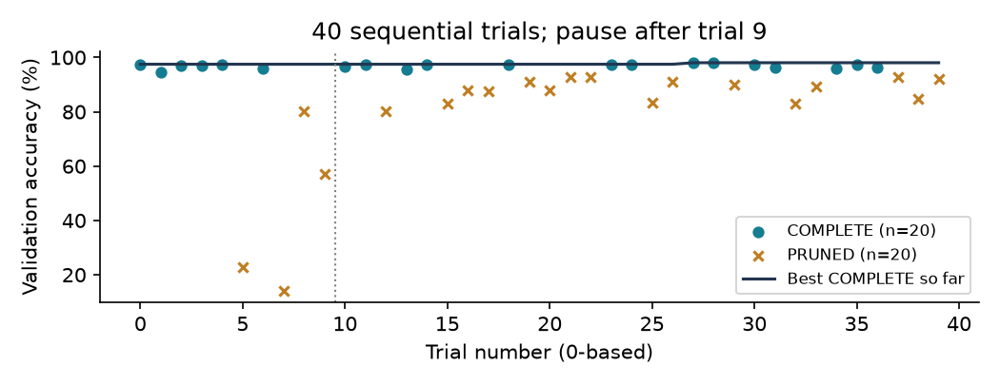
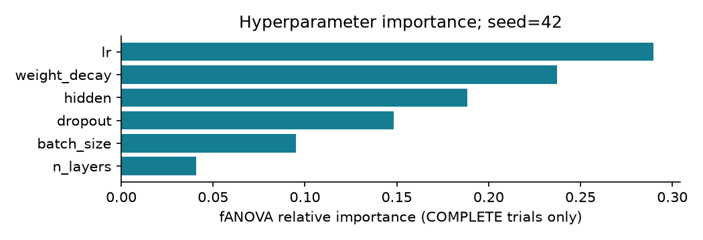

# ЛР0. Воспроизводимый эксперимент и подбор гиперпараметров

## Вопрос, прогноз и метод
Это независимый повтор фиксированного протокола; все числа получены заново. Прогноз учитывает прежний опыт. Это разбиение test уже оценивалось ранее и не объявляется совершенно новым; прежний test не использован для изменения поиска или правила выбора.
Превышает ли эффект подбора гиперпараметров случайный разброс? До итоговых запусков зафиксирован прогноз: базовая accuracy на val 94–97%, размах по пяти seed 0,3–1,5 п.п.; лучший trial может дать 0–2 п.п., но преимущество на новых seed и test может уменьшиться.

load_digits: 1797 изображений 8×8; стратифицированное разбиение с split_seed=0 на 1077/360/360. Признаки делятся на 16. MLP: 64→скрытые слои ReLU+dropout→10, Adam, 30 эпох, CPU, один поток. База: один слой 64, dropout=0, lr=0.001, weight_decay=0, batch_size=64. Окружение: torch 2.6.0, scikit-learn 1.9.1, numpy 2.1.3, optuna 5.0.0, mlflow 3.17.2, PyYAML 6.0.2. Для каждого запуска сохранены полный коммит, конфигурация, SHA-256, метаданные и предсказания.

## 1. Повторяемость и разброс
Два запуска seed 0 дали побайтно одинаковые predictions.csv и точно одинаковые значения train_loss/val_loss/val_acc. Реальные epoch_s различаются, поэтому history.csv целиком не совпадает. Требования полного совпадения файла и записи реального времени противоречат друг другу; время не подменялось. Измеряется сумма времени обучения и валидации, без подготовки, записи CSV и MLflow. Знаменатель каждого val — 360 изображений.

| seed | val accuracy (%) | compute time (s) | run_id |
| --- | --- | --- | --- |
| 1 | 96.111 | 0.325 | 20261102T105721_119e1162 |
| 2 | 95.556 | 0.319 | 20261102T105730_f9cf98c3 |
| 3 | 95.278 | 0.361 | 20261102T105739_b60a16cb |
| 4 | 95.278 | 0.340 | 20261102T105749_45fe80de |
| 5 | 95.556 | 0.356 | 20261102T105758_97bb3aed |

Минимум/медиана/максимум: 95.278/95.556/96.111%; размах 0.833 п.п. Переход seed 1→2: исправлено 1, испорчено 3, оба верны 343, оба ошиблись 13 из 360.

## 2. Поиск
40 последовательных trial, TPE(seed=42), MedianPruner(startup=5,warmup=5), seed обучения 0. Диапазоны заданы в configs/search.yaml, цель — accuracy последней, 30-й эпохи на val. После 10 trial выполнена запланированная пауза, затем продолжение до 40. Это проверка возобновления между trial, а не аварийного завершения внутри эпохи. SQLite сохраняет trial; состояние генератора семплера при рестарте не восстанавливается, поэтому последовательность не приравнивается к непрерывному поиску.

COMPLETE=20, PRUNED=20, FAIL=0. Выполнено 700/1200 эпох; сэкономлено 500 (41.7%). Измеренное время вычислений поиска 22.514 с. Экстраполяция среднего времени выполненных эпох отдельно для каждого trial даёт оценку экономии 12.537 с. Это контрфактическая оценка, а не измерение поиска без прунера. Значения PRUNED относятся к последней выполненной эпохе; fANOVA использует только COMPLETE и не является причинной оценкой.

Лучший trial #27: val=98.056%; параметры `{"lr": 0.0030037042341145384, "n_layers": 3, "hidden": 318, "dropout": 0.3022047077099191, "weight_decay": 1.4076637754695788e-05, "batch_size": 128}`. Конфигурация выбрана только по val и закоммичена до первого вычисления test.

## 3. Честное сравнение
На новых seed 101–105 выполнено 10 заранее заданных запусков base/best из одного коммита. Знаменатель val и test каждого запуска — 360. Test не использовался для изменения конфигураций.

| seed | base val % | best val % | Δ val (pp) | base test % | best test % | Δ test (pp) | fixed / broken |
| --- | --- | --- | --- | --- | --- | --- | --- |
| 101 | 95.278 | 97.222 | 1.944 | 95.278 | 96.111 | 0.833 | 8 / 5 |
| 102 | 95.556 | 96.944 | 1.389 | 94.722 | 96.111 | 1.389 | 11 / 6 |
| 103 | 95.556 | 97.778 | 2.222 | 93.889 | 96.944 | 3.056 | 13 / 2 |
| 104 | 95.278 | 97.222 | 1.944 | 94.722 | 97.222 | 2.500 | 10 / 1 |
| 105 | 95.278 | 97.778 | 2.500 | 95.278 | 97.222 | 1.944 | 9 / 2 |

Медиана Δval 1.944 п.п., диапазон [1.389, 2.500]; медиана Δtest 1.944 п.п., диапазон [0.833, 3.056]. Всего на test исправлено 51, испорчено 16 из 1800 наблюдений «seed–изображение»; это не 1800 независимых изображений.

Три оценки: лучший trial val 98.056%; средняя best val на новых seed 97.389%; средняя best test 96.722%. Изменение среднего val относительно лучшего trial -0.667 п.п.; test относительно нового val -0.667 п.п. Отбор, случайность обучения и различие выборок могут влиять одновременно; эти числа сами по себе не разделяют причины.

Сверка прогноза: базовая accuracy и размах попали в ожидаемый диапазон. Прирост лучшего trial относительно базы seed 0 — 3.056 п.п., выше прогноза 0–2. Возможна роль сочетания глубины и lr, но без абляций причины не разделены. Среднее best val на новых seed ниже максимума поиска, как ожидалось.

## Вывод и проверка
Критерий устойчивого улучшения не выполнен: не все пять разностей на test превышают базовый разброс на val. Даже если все разности положительны, малый эффект нельзя объявлять доказанным общим улучшением. Вывод ограничен данным разбиением, MLP, 30 эпохами и пятью новыми seed. Одна ошибка из 360 — около 0,278 п.п.; статистическая значимость не заявляется. Несовпадение с прогнозом не скрывается.

Код создан с помощью Codex. Проверки: известная accuracy=0,75; непересечение частей и хеши; отказ при lr=-1 и грязном Git; точное совпадение повторных предсказаний; пересчёт метрик всех запусков; 40 trial без скрытых повторов. Таблицы и рисунки автоматически создаёт analyze.py. Соответствие final run_id: generated/final_run_ids.md; полный аудит: generated/summary.json. Для защиты студент должен самостоятельно понимать и объяснять код и результаты.
