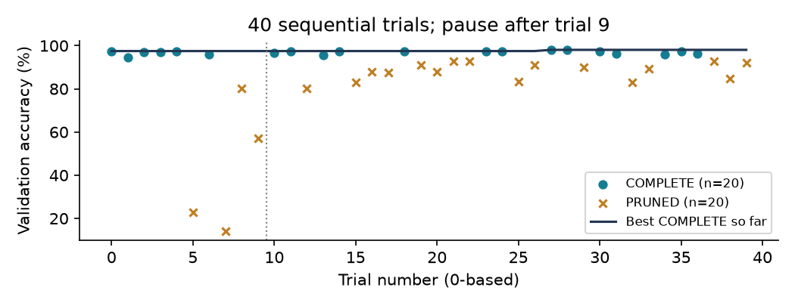
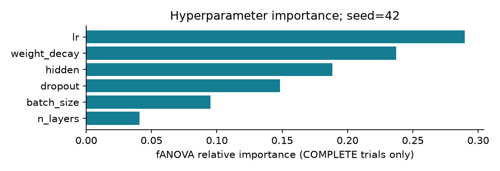

# 实验 0：可复现训练与超参数搜索

## 问题、预测与方法
本次是相同固定协议的独立重跑，所有数字来自新运行；预测参考了先前经验，test 划分曾在旧版本中评估，不将它称为从未见过的新测试集。本次不根据旧 test 结果更改参数搜索或选择规则。
调参带来的提升是否超过随机种子造成的波动？预测已在正式实验前提交：基础 val 约 94–97%，五 seed 极差约 0.3–1.5 个百分点；最佳 trial 或提升 0–2 个百分点，但在新 seed/test 上优势可能缩小。

load_digits 共 1797 个 8×8 图像，按指定分层方法和 split_seed=0 划分 train/val/test=1077/360/360，特征除以 16。MLP 为 64→隐藏层（ReLU+dropout）→10；Adam、30 轮、CPU 单线程。基础配置：1×64、dropout=0、lr=0.001、weight_decay=0、batch_size=64。版本：torch 2.6.0, scikit-learn 1.9.1, numpy 2.1.3, optuna 5.0.0, mlflow 3.17.2, PyYAML 6.0.2。所有正式运行均记录完整 Git 提交、SHA-256、配置、时间和逐例预测。

## 实验 1：可复现性与随机波动
seed 0 两次预测文件逐字节一致，训练/验证指标逐项完全一致。history.csv 的真实 epoch_s 不同，因此文件整体不逐字节相同；此处是作业中“记录真实耗时”与“整个 history 完全相同”的冲突，未伪造计时。以下时间为训练加验证计算，不含初始化、日志和文件写入。每次 val 分母为 360。

| seed | val accuracy (%) | compute time (s) | run_id |
| --- | --- | --- | --- |
| 1 | 96.111 | 0.325 | 20261102T105721_119e1162 |
| 2 | 95.556 | 0.319 | 20261102T105730_f9cf98c3 |
| 3 | 95.278 | 0.361 | 20261102T105739_b60a16cb |
| 4 | 95.278 | 0.340 | 20261102T105749_45fe80de |
| 5 | 95.556 | 0.356 | 20261102T105758_97bb3aed |

val 最小/中位/最大为 95.278/95.556/96.111%，极差 0.833 个百分点。seed 1→2：纠正 1 张，破坏 3 张；两者都对 343 张、都错 13 张，合计 360。

## 实验 2：40 次顺序搜索
TPE(seed=42)，MedianPruner(startup=5,warmup=5)，训练 seed=0。搜索范围见 configs/search.yaml；目标为第 30 轮 val 准确率。完成 10 次后有计划暂停，重启补齐至 40；不是强制杀进程的崩溃恢复测试。SQLite 保留 trial，但重启不恢复 sampler 随机状态，因此不声称与未中断序列相同。

COMPLETE=20，PRUNED=20，FAIL=0。实际 700/1200 轮，节约 500 轮（41.7%）。实测搜索计算耗时 22.514 s；逐 trial 使用已执行轮的平均耗时外推，估计节约 12.537 s，属于反事实估算，未实际运行无剪枝对照。剪枝点的末次准确率不等于完整 30 轮最终准确率；fANOVA 只使用完成 trial，不能当成因果结论。

最佳 trial #27，val=98.056%；参数 `{"lr": 0.0030037042341145384, "n_layers": 3, "hidden": 318, "dropout": 0.3022047077099191, "weight_decay": 1.4076637754695788e-05, "batch_size": 128}`。配置只依 val 选定，并在读取 test 之前单独提交冻结。

## 实验 3：新 seed 上配对比较
使用 seed 101–105，各训练基础/最佳配置一次，预先指定的 10 次 final 运行使用同一提交。每个 val/test 分母 360；没有根据 test 调参或替换运行。

| seed | base val % | best val % | Δ val (pp) | base test % | best test % | Δ test (pp) | fixed / broken |
| --- | --- | --- | --- | --- | --- | --- | --- |
| 101 | 95.278 | 97.222 | 1.944 | 95.278 | 96.111 | 0.833 | 8 / 5 |
| 102 | 95.556 | 96.944 | 1.389 | 94.722 | 96.111 | 1.389 | 11 / 6 |
| 103 | 95.556 | 97.778 | 2.222 | 93.889 | 96.944 | 3.056 | 13 / 2 |
| 104 | 95.278 | 97.222 | 1.944 | 94.722 | 97.222 | 2.500 | 10 / 1 |
| 105 | 95.278 | 97.778 | 2.500 | 95.278 | 97.222 | 1.944 | 9 / 2 |

Δval 中位数 1.944 pp，范围 [1.389, 2.500]；Δtest 中位数 1.944 pp，范围 [0.833, 3.056]。五组 test 合计纠正 51、破坏 16，分母 5×360=1800 个“seed-图像”观察，并非 1800 张独立图像。

搜索最佳 val=98.056%；新 seed 最佳配置平均 val=97.389%；平均 test=96.722%。重训均值相对搜索最好值变化 -0.667 pp；test 相对新 seed val 变化 -0.667 pp。选择偏差、训练随机性和样本差异都可能参与，不能只凭三个数字把变化全归因于某一个因素。

预测对照：基础准确率和极差在预期范围内；搜索最好值相对基础 seed 0 提高 3.056 pp，超过原先 0–2 pp 的预期。多层网络与学习率的配合可能是原因，但没有消融实验，不能分离贡献。新 seed 的最佳配置平均 val 低于搜索最好值，符合优势可能缩小的预测。

## 结论与验证
按课程判据，不能认定改善稳定：并非五个 test 差值都大于基础 val 波动。若差值全正但较小，只能说这五次观察到正向趋势；不能把趋势写成已证实的普遍提升。 结论仅适用于本数据划分、模型、30 轮和五个新 seed。360 张图像中一张约 0.278 pp；样本较小，未声称统计显著性。预测是否成立应以上述实测值为准，负面结果保留。

代码由 Codex 协助生成；通过已知 0.75 准确率用例、划分/哈希、负学习率拒绝、Git 脏目录拒绝等单元测试，并对全部运行重算指标、核对重复运行及 trial 数量。所有数值由 analyze.py 从 CSV/数据库计算；运行 ID 映射见 generated/final_run_ids.md，完整审计见 generated/summary.json。学习者仍需自行读懂代码并完成答辩。
